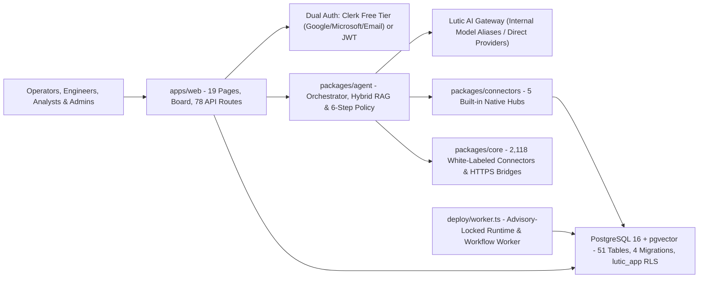
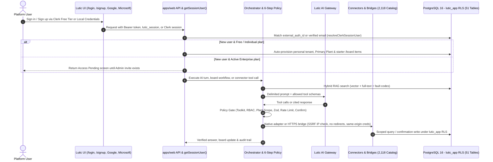
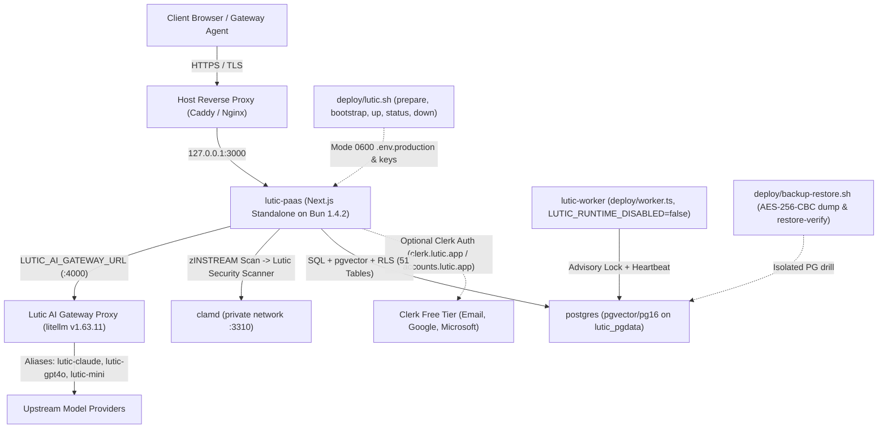
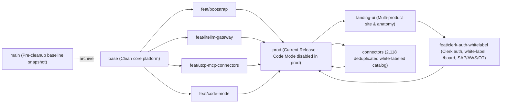

# Lutic — AI Systems & Industrial Operations Platform (`lutic.app`)

Lutic ([lutic.app](https://lutic.app)) is a multi-tenant AI systems and industrial operations platform built for **AI Automations**, **Agentic Dashboards**, **Autonomous Multi-Agent Systems**, **Linear/Jira-Style Execution Boards**, and role-governed shop-floor intelligence across manuals, live telemetry, alarms, work orders, external SaaS/ERP/OT connectors, and messaging queues.

See [PRODUCTION.md](PRODUCTION.md) for deployment, Clerk custom-domain configuration, bootstrap, backups, and staging verification, and [SECURITY.md](SECURITY.md) for the threat model and security controls.

---

## Platform Overview

- **Workspaces (`4` packages)**: `@lutic/core`, `@lutic/connectors`, `@lutic/agent`, `@lutic/web`
- **Web & API Surface (`apps/web`)**: `19` App Router pages (including multi-product landing `/`, white-labeled `/login`, `/signup`, `/sso-callback`, and Kanban/List execution `/board`) and `78` API route handlers backed by Next.js 15 (`lutic_session` cookies, optional Clerk Free Tier Email + Google/Microsoft auth, CSRF/Origin guards, and scoped `CORS_ORIGINS`)
- **Data & Semantic Layer (`packages/core`)**: `51` Drizzle ORM tables across `4` versioned migrations (`0001` baseline, `0002` account lifecycle & ingestion tokens, `0003` Clerk identity linking, `tenants.plan`, and `board_issues`, `0004` 1536-dim HNSW dense embeddings and `worker_heartbeats` revoked from `lutic_app`), PostgreSQL 16 + `pgvector` with `lutic_app` row-level security (`withTenantScope`), `12` governed semantic metrics (`oee`, `availability`, `performance`, `quality`, `downtime_minutes`, `scrap_rate`, `throughput`, `mtbf`, `mttr`, `energy_kwh`, `open_work_orders`, `parts_below_min_stock`), AES-256-GCM encrypted connector credentials, and `kjt_` telemetry ingestion tokens
- **AI, White-Labeling & `2,118` Connectors (`packages/agent` & `packages/connectors` & `packages/core`)**: Incremental `streamText` SSE streaming orchestrator (latest-20 context window, short-lived DB transactions outside LLM loops, specialist routing & `safety_verifier` gate, cost tracking, multiple `pendingActions`), 6-step Policy Engine, 4-way Hybrid RAG (64-dim local + optional 1536-dim `lutic-embed`/OpenAI dense vectors + full-text + fault-code boost + `HybridLexicalSemanticReranker`), `5` built-in native hubs (`docs`, `historian`, `cmms`, `parts-erp`, `mes`), `11` SAP/AWS/ServiceNow/MQTT/OPC-UA/Modbus adapters (live binary Modbus TCP, binary MQTT 3.1.1, and DNS-pinned HTTPS ServiceNow/SAP OData/Jira/Linear/Slack runtimes plus demo simulation), `3` DNS-pinned HTTPS bridges (`lutic-cloud`, `lutic-bridge`, `lutic-api`), `1` generic HTTP webhook, `2,098` catalog bridge templates ([connector-catalog.generated.json](packages/core/src/connector-catalog.generated.json)), durable step-checkpointed workflows with retries + `lutic-worker` background daemon, and sanitized **Lutic Security Scanner** & **Lutic AI Gateway** routing

---

## Architecture Diagrams

### 1. Short Platform Overview



### 2. Detailed Auth, Provisioning, Governance & Execution Flow



### 3. Production Deployment Topology



### 4. Git Branch Architecture



| Branch | Purpose |
| --- | --- |
| `base` | Clean core platform (Playwright, mobile, evals, license-server fixture, and internal dev plans removed). |
| `feat/bootstrap` | Production self-bootstrap (`db:bootstrap`, `deploy/lutic.sh bootstrap`), auto-generated gateway keys, built-in adapters, default topic & queue. |
| `feat/litellm-gateway` | Self-hosted AI gateway Compose service ([docker-compose.yml](docker-compose.yml)) and [deploy/litellm_config.yaml](deploy/litellm_config.yaml). |
| `feat/utcp-mcp-connectors` | Streamable HTTPS connector bridges (`remote_mcp`, `utcp_http`), same-origin credential guard, and manifest export (`GET /api/connectors/utcp`). |
| `feat/code-mode` | Isolated subprocess Code Mode worker and playground UI (gated to `development` and `test` via `isCodeModeEnabled()`). |
| `landing-ui` | Public multi-product `lutic.app` website covering AI Automations, Agentic Dashboards, Multi-Agent Systems, Industrial Ops, and isometric plant anatomy. |
| `feat/clerk-auth-whitelabel` | Migration `v3`, Clerk Free Tier Email/Google/Microsoft custom UI, Free auto-provisioning vs Enterprise invite-only mode, full white-labeling, SAP/AWS/ServiceNow/OT connectors, and Kanban/List `/board`. |
| `connectors` | Deduplicated catalog generator ([sync-connector-catalog.ts](packages/core/scripts/sync-connector-catalog.ts)) importing `2,098` unique integrations (`2,118` total) with paginated Catalog UI (`60`/page). |
| `prod` | Integrated client release combining all branches with production Code Mode fail-closed guards (`597e574` + current docs sync). |

---

## Quick Start

### Local Development Demo

1. Install dependencies using [Bun](https://bun.sh) 1.4.2 (the version pinned in CI):
   ```bash
   bun install --frozen-lockfile
   ```
2. Optionally copy `.env.example` to `.env`. Local defaults run an embedded storage engine with `pgvector` at `.data/pglite`, deterministic local embeddings, an offline `mock` chat provider, seeded SAP/AWS/ServiceNow/MQTT/OPC-UA/Modbus connectors, and `8` seeded `/board` issues (`LUT-101`..`LUT-108`).
3. To test **Clerk Free Tier (Email/Password + Google + Microsoft)** locally, set `NEXT_PUBLIC_CLERK_PUBLISHABLE_KEY`, `CLERK_SECRET_KEY`, `NEXT_PUBLIC_CLERK_OAUTH_PROVIDERS=google,microsoft`, and `LUTIC_DEPLOYMENT_PLAN=free` (or `enterprise` for invite-only verification) in `.env.local`. Leaving those blank keeps built-in password + dev persona switching active.
4. Start the server (auto-seeds on first dev request, or run `bun run db:seed` explicitly):
   ```bash
   bun run db:seed
   bun run dev
   ```
   Open [http://localhost:3000](http://localhost:3000) and optionally run `bun run sim` in a second terminal to stream simulated telemetry and alarms.

#### Dev-Only Demo Accounts (Password: `lutic-demo-password`)

| Role | Email | Authorized Plants | Capabilities |
| --- | --- | --- | --- |
| `engineer` | `engineer@acme.demo` | Detroit (`plant-detroit`) | Manuals, alarms, telemetry, work orders, `/board`, parts, confirmed drafts. |
| `engineer` | `austin.engineer@acme.demo` | Austin (`plant-austin`) | Strictly scoped to Austin assets, `/board` plant items, alarms, and spare parts. |
| `analyst` | `analyst@acme.demo` | Detroit & Austin | Engineer reads + 12 semantic metrics + dashboard builder & sharing. |
| `manager` | `manager@acme.demo` | Detroit & Austin | Multi-plant views, alerts, notifications, and `/board` read access. |
| `admin` | `admin@acme.demo` | Detroit & Austin | Full platform + `/admin` (users, `2,118` connectors catalog, toolkits, knowledge ingestion, audit CSV, assets/QR). |

### Production Bootstrap & Startup

Production refuses `db:seed` and demo sign-in. Provision PostgreSQL 16 + `pgvector`, generate secrets (`bash deploy/lutic.sh prepare`), bootstrap the first tenant/plant/admin (`bash deploy/lutic.sh bootstrap` or `bun run db:bootstrap`), and launch Compose (`bash deploy/lutic.sh up`). Bootstrap initializes core toolkits, the `5` built-in adapters (without demo credentials), the `plant-alerts` topic, and the `ops-dispatch` queue without inserting synthetic assets or telemetry. See [PRODUCTION.md](PRODUCTION.md).

---

## Integrations & Production Boundaries

- **Auth & Provisioning**: [auth.ts](apps/web/src/lib/auth.ts) checks explicit `Authorization: Bearer ...` and `lutic_session` tokens first, falling back to `getClerkServerSessionUser()` ([clerk.ts](apps/web/src/lib/clerk.ts)) when Clerk keys are configured. New verified Clerk sign-ups receive a personal Free workspace (`tenants.plan = 'free'`, starter `Primary Plant`, and `3` starter `/board` items) when Free/Individual is active, or see **Access Pending** if `LUTIC_DEPLOYMENT_PLAN=enterprise` / an active Enterprise license is present without an invited user row.
- **White-Labeled Security Scanner & AI Gateway**: All user-facing diagnostics report **Lutic Security Scanner** ([scan.ts](packages/agent/src/rag/scan.ts)) and **Lutic AI Gateway** without exposing internal vendor names (`ClamAV`, `LiteLLM`, `Metorial`, `OpenConnectors`, `UTCP`, `PGlite`).
- **`2,118` Connectors & Bridges**: Combines `5` native hubs (`Native`), `3` HTTPS cloud/API bridges (`HTTPS Bridge`: `lutic-cloud`, `lutic-bridge`, `lutic-api`), `11` industrial/enterprise adapters (`Live Protocol`: binary Modbus TCP & MQTT 3.1.1 wire clients plus DNS-pinned HTTPS ServiceNow/SAP OData/Jira/Linear/Slack REST runtimes, with full demo simulation under demo mode), `1` generic HTTP webhook, and `2,098` catalog bridge templates ([external-connectors.ts](packages/core/src/external-connectors.ts), [live-adapters.ts](packages/core/src/live-adapters.ts)). All outbound HTTP(S) connector requests enforce single-lookup pinned-IP transport (`safePinnedHttpRequest`), SNI, disabled 3xx redirects, 1 MiB response caps, 15s timeouts, and same-origin credential scoping.
- **Operations & Execution Board (`/board`)**: Multi-tenant Kanban & List board backed by `board_issues` (`51` total schema tables; tenant tables scoped under `lutic_app` RLS) via [api/board/route.ts](apps/web/src/app/api/board/route.ts) and [api/board/[id]/route.ts](apps/web/src/app/api/board/[id]/route.ts) with sequential `LUT-XXX` keys, drag-and-drop status changes, priority/workstream filtering, and plant-scoped RBAC (`workorder:read` / `workorder:write`).
- **Production Boundaries & Durable Runtime**:
  - **Lutic Code Mode (`isCodeModeEnabled()`)**: Restricted strictly to `NODE_ENV=development` and `test`; disabled fail-closed in production (`HTTP 501`).
  - **Simulated Catalog Templates & HTTP 501 Stubs**: Catalog bridge templates and simulated demo connectors execute synthetic simulations under demo mode; in non-demo production, only native hubs, live wire/REST adapters (`modbus://`, `mqtt(s)://`, live HTTPS ServiceNow/SAP/Jira/Linear/Slack), and `remote_mcp`/`utcp_http` HTTPS bridges invoke external systems (generic HTTP/webhook stubs return `HTTP 501`).
  - **Embeddings, Workflows & Dedicated Worker**: `getDefaultEmbeddingProvider()` supports deterministic 64-dim local embeddings alongside 1536-dim `lutic-embed` / OpenAI semantic embeddings (`dense_embedding` HNSW index) with 4-way RRF and `HybridLexicalSemanticReranker`. Workflows persist per-step checkpoints and retry attempts (`resumeWorkflowRun`, fail-closed production AI executor), executed by `lutic-worker` ([worker.ts](deploy/worker.ts)) while `lutic-paas` runs with `LUTIC_RUNTIME_DISABLED=true`. PDF manuals must contain extractable text (OCR is not built in).

---

## Scripts & Verification

```bash
bun run db:migrate   # Apply versioned schema migrations (v1..v4) under advisory lock
bun run db:bootstrap # Idempotent clean production tenant/plant/admin setup
bun run db:seed      # Dev-only synthetic plant, 1536-dim RAG, worker & board seed (rejected in production)
bun run sim          # Dev-only telemetry & alarm simulator
bun run typecheck    # Strict TypeScript check across all 4 packages
bun run lint         # ESLint (@lutic/web) + tsc --noEmit (core/connectors/agent)
bun run test         # Vitest suite (21 test files, 138 total tests)
bun run build        # Production Next.js build + workspace TypeScript checks
```

Locally on `feat/v2-engineering-upgrades` (merged to `prod`), `typecheck`, `lint`, `build`, `bun audit --audit-level=high` (`0` vulnerabilities across `768` packages), and `131` Vitest tests across `20` runnable files (`tests/postgres-integration.test.ts` skips `7` tests locally when `POSTGRES_TEST_URL` is unset) all passed. GitHub Actions ([.github/workflows/ci.yml](.github/workflows/ci.yml)) runs all `138` tests (including native `pgvector/pg16`), dependency audit, and Docker `container-smoke` (verifying `"currentVersion":4`); live HTTPS TLS termination, live Clerk OAuth/custom domain `lutic.app` CNAMEs, live scanner uploads, live AI Gateway upstream calls, and off-host backup restores remain pending target private-staging verification.
