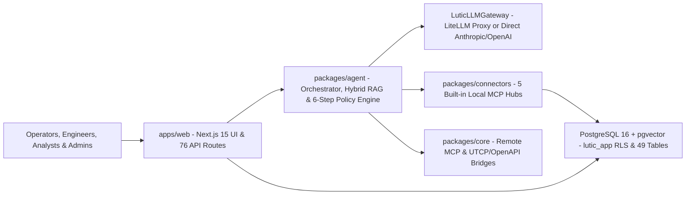
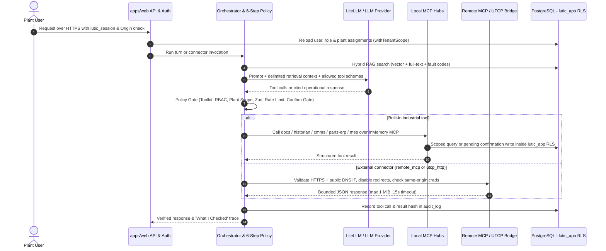
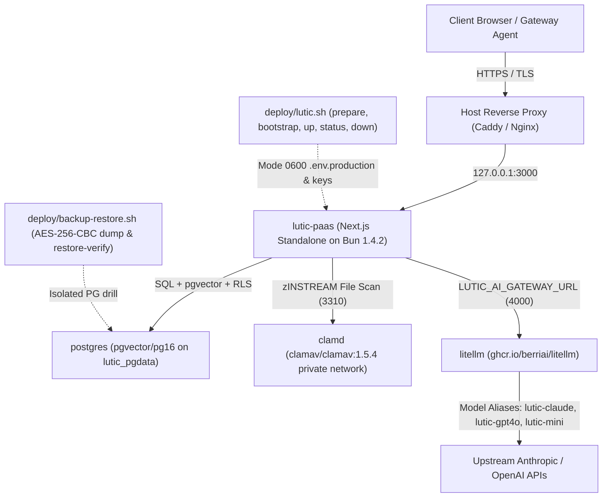
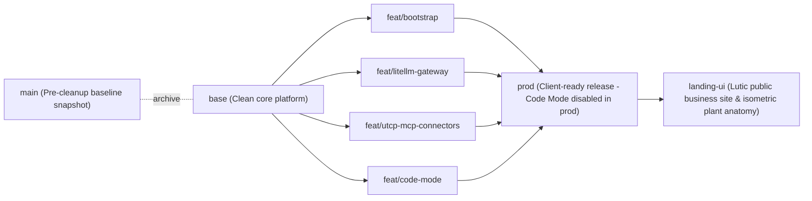

# Lutic — Industrial Operations Platform (`lutic.app`)

Lutic ([lutic.app](https://lutic.app)) is a multi-tenant industrial operations platform for role-governed access to plant manuals, live machine telemetry, alarms, work orders, external SaaS/API connectors (Remote MCP & UTCP/OpenAPI), messaging queues, and operational dashboards.

See [PRODUCTION.md](PRODUCTION.md) for deployment, bootstrap, backups, and staging verification, and [SECURITY.md](SECURITY.md) for the threat model and security controls.

---

## Platform Overview

- **Workspaces (`4` packages)**: `@lutic/core`, `@lutic/connectors`, `@lutic/agent`, `@lutic/web`
- **Web & API Surface (`apps/web`)**: `16` App Router pages and `76` API route handlers backed by Next.js 15 (`lutic_session` cookies, CSRF/Origin guards, and scoped `CORS_ORIGINS`)
- **Data & Semantic Layer (`packages/core`)**: `49` Drizzle ORM tables on PostgreSQL 16 + `pgvector`, `lutic_app` row-level security (`withTenantScope`), `12` governed semantic metrics (`oee`, `availability`, `performance`, `quality`, `downtime_minutes`, `scrap_rate`, `throughput`, `mtbf`, `mttr`, `energy_kwh`, `open_work_orders`, `parts_below_min_stock`), AES-256-GCM encrypted connector credentials, and `kjt_` telemetry ingestion tokens
- **AI, Connectors & Bridges (`packages/agent` & `packages/connectors`)**: Orchestrator (default `8` steps, max `12`) feeding a 6-step Policy Engine, Hybrid RAG (64-dim deterministic local embeddings + full-text search + fault-code boost), `5` local MCP hubs (`docs`, `historian`, `cmms`, `parts-erp`, `mes`), SSRF-checked Streamable HTTP Remote MCP (`remote_mcp`) and UTCP 1.0 / OpenAPI 3.x (`utcp_http`) bridges, and `LuticLLMGateway`

---

## Architecture Diagrams

### 1. Short Platform Overview



### 2. Detailed Request, Governance & Execution Flow



### 3. Production Deployment Topology



### 4. Git Branch Architecture



| Branch | Purpose |
| --- | --- |
| `base` | Clean core Lutic platform (Playwright, mobile, evals, license-server fixture, and internal dev plans removed). |
| `feat/bootstrap` | Production self-bootstrap (`db:bootstrap`, `deploy/lutic.sh bootstrap`), auto-generated gateway keys, built-in `mcp://` connections, default topic & queue. |
| `feat/litellm-gateway` | Self-hosted LiteLLM Compose service ([docker-compose.yml](docker-compose.yml)) and [deploy/litellm_config.yaml](deploy/litellm_config.yaml). |
| `feat/utcp-mcp-connectors` | Streamable HTTP Remote MCP (`remote_mcp`), UTCP 1.0 / OpenAPI 3.x HTTP bridges (`utcp_http`), same-origin credential guard, and `GET /api/connectors/utcp`. |
| `feat/code-mode` | Isolated subprocess Code Mode worker and playground UI (gated to `development` and `test` via `isCodeModeEnabled()`). |
| `prod` | Integrated client release combining all `feat/*` branches with production Code Mode fail-closed guards. |
| `landing-ui` | Public business-facing landing page & interactive isometric plant anatomy branched from `prod`. |

*(Note: `main`, `base`, and `feat/*` branch histories retain earlier commits from before the `prod` rename to `lutic.app`; `prod` and `landing-ui` carry the full `Lutic` rename.)*

---

## Quick Start

### Local Development Demo

1. Install dependencies using [Bun](https://bun.sh) 1.4.2 (the version pinned in CI):
   ```bash
   bun install --frozen-lockfile
   ```
2. Optionally copy `.env.example` to `.env`. Local defaults run embedded PGlite with `pgvector` at `.data/pglite`, deterministic local embeddings, and an offline `mock` chat provider (no external API keys required).
3. Seed the two synthetic plants (`plant-detroit`, `plant-austin`) and start the dev server:
   ```bash
   bun run db:seed
   bun run dev
   ```
   Open [http://localhost:3000](http://localhost:3000) and run `bun run sim` in a second terminal to stream simulated telemetry and alarms.

#### Dev-Only Demo Accounts (Password: `lutic-demo-password`)

| Role | Email | Authorized Plants | Capabilities |
| --- | --- | --- | --- |
| `engineer` | `engineer@acme.demo` | Detroit (`plant-detroit`) | Manuals, alarms, telemetry, work orders, parts, confirmed drafts. No analytics/dashboard edits. |
| `engineer` | `austin.engineer@acme.demo` | Austin (`plant-austin`) | Strictly scoped to Austin assets, alarms, and spare parts. |
| `analyst` | `analyst@acme.demo` | Detroit & Austin | Engineer reads + 12 semantic metrics + dashboard builder & sharing. |
| `manager` | `manager@acme.demo` | Detroit & Austin | Read-only access to chat, metrics, and shared dashboards. |
| `admin` | `admin@acme.demo` | Detroit & Austin | Full platform + `/admin` (users, encrypted connectors, toolkits, knowledge ingestion, audit CSV, assets/QR). |

### Production Bootstrap & Startup

Production refuses `db:seed` and demo sign-in. Provision PostgreSQL 16 + `pgvector`, generate secrets (`bash deploy/lutic.sh prepare`), bootstrap the first tenant/plant/admin (`bash deploy/lutic.sh bootstrap` or `bun run db:bootstrap`), and launch Compose (`bash deploy/lutic.sh up`). Bootstrap initializes core toolkits, the `5` built-in local `mcp://` connectors (without demo credentials), the `plant-alerts` topic, and the `ops-dispatch` queue without inserting synthetic assets or telemetry. See [PRODUCTION.md](PRODUCTION.md).

---

## Integrations & Production Boundaries

- **LiteLLM Proxy (`LUTIC_AI_GATEWAY_URL`)**: Configured in [docker-compose.yml](docker-compose.yml) via [deploy/litellm_config.yaml](deploy/litellm_config.yaml) routing `lutic-claude`, `lutic-gpt4o`, and `lutic-mini` through `LuticLLMGateway`, with direct Anthropic and OpenAI fallback support.
- **Remote MCP & UTCP / OpenAPI Connectors**: Built-in local hubs (`lutic://` / `mcp://`), Streamable HTTP Remote MCP (`remote_mcp` for Metorial, OpenConnectors, UTCP-MCP), UTCP 1.0 & OpenAPI 3.x HTTP manuals (`utcp_http`), and tenant UTCP export (`GET /api/connectors/utcp`). All external requests enforce HTTPS (unless `LUTIC_ALLOW_PRIVATE_CONNECTOR_URLS=true` in test), private/loopback/metadata IP blocking (including post-DNS resolution checks), disabled redirects, 1 MiB response caps, 15s timeouts, and **same-origin credential scoping** (`external-connectors.ts`).
- **Telemetry Ingestion (`POST /api/telemetry`)**: Accepts batches of 1–100 snapshots authenticated by plant-scoped gateway tokens (`kjt_...`).
- **Production Boundaries & Disabled Paths**:
  - **Lutic Code Mode (`isCodeModeEnabled()`)**: Restricted strictly to `NODE_ENV=development` and `test`; disabled fail-closed across UI (`capabilities.codeMode: false`), API (`HTTP 501`), policy (`getAllowedToolsForUser`), and shared executor (`executeLuticConnectorCode`) in production.
  - **HTTP 501 Unimplemented Stubs**: Raw `http`/`webhook` test/sync/invoke paths, webhook pub/sub delivery (`subscriptions`), and workflow AI nodes store configuration cleanly or reject with `HTTP 501` in production.
  - **Embeddings & PDFs**: Embeddings are deterministic 64-dimensional local vectors; PDF manuals must contain extractable text (OCR is not built in).

---

## Scripts & Verification

```bash
bun run db:migrate  # Apply versioned schema migrations under advisory lock
bun run db:bootstrap # Idempotent clean production tenant/plant/admin setup
bun run db:seed     # Dev-only synthetic plant seed (rejected in production)
bun run sim         # Dev-only telemetry & alarm simulator
bun run typecheck   # Strict TypeScript check across all 4 packages
bun run lint        # ESLint (@lutic/web) + tsc --noEmit (core/connectors/agent)
bun run test        # Vitest suite (19 test files, 128 total tests)
bun run build       # Production Next.js build + workspace TypeScript checks
```

Locally on `prod`, `db:seed`, `bun install --frozen-lockfile --dry-run`, `typecheck`, `lint`, `build`, and `121` PGlite/unit/security/UTCP-MCP/Code Mode/deploy tests (`18` files) passed (`tests/postgres-integration.test.ts` skips `7` tests locally when `POSTGRES_TEST_URL` is unset). GitHub Actions ([.github/workflows/ci.yml](.github/workflows/ci.yml)) runs all `128` tests (including native `pgvector/pg16`), dependency audit, and Docker `container-smoke`; live HTTPS TLS termination, real `clamd` uploads, live LiteLLM upstream calls, and off-host backup restores remain pending private-staging verification.
