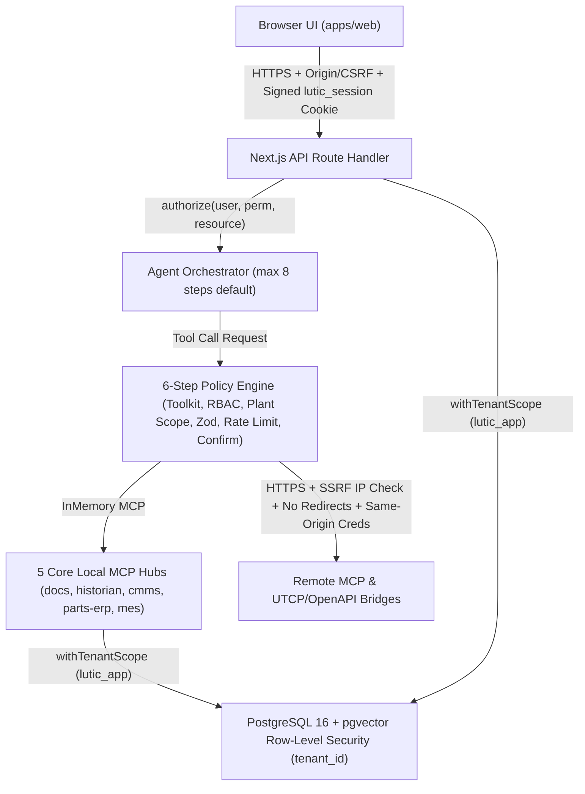

# Lutic Security and Threat Model

## 1. Security Architecture Overview

Lutic enforces authorization, tenant isolation, and tool access in server-side code. Production deployment calls for PostgreSQL with `pgvector`, TLS at the web ingress, unique secrets, and ClamAV for uploads. See the [production deployment guide](PRODUCTION.md).

## 2. Threat Model & Mitigations

### A. Prompt Injection and Model Context

Retrieved documents and tool results are delimited as untrusted data in the prompt. The policy engine separately enforces toolkit membership, permissions, plant scope, argument validation, and tool-specific result bounds. Connector credential handling stays server-side.

When chat uses an external LLM, it sends prompts and selected retrieval or tool context to the configured provider. Retrieval embeddings are computed locally using a deterministic algorithm.

### B. Role and Plant Scope

Session lookups verify the signed token and reload the active user, role, and plant assignments from the database. API and tool permission checks use that scope. Dashboard queries enforce metric and plant permissions per widget, and denied tool calls are audited.

### C. Cross-Tenant Access

Tenant routes and server pages use a transaction under the restricted application role. `withTenantScope` sets the tenant ID for that transaction. PostgreSQL row-level security hides rows from other tenants and rejects writes outside the scope. An empty tenant context gives the application role access to zero tenant rows. Bootstrap, initial identity lookup, and cross-tenant background jobs use explicit administrative access.

### D. Writes, External Connectors & Code Mode

Agent work-order and part-reservation tools first create a pending action. Confirmation verifies the user and uses an idempotency key. Authorized workflow steps can create local work orders, in-app notifications, and queue messages. Remote MCP (`remote_mcp`) and UTCP/OpenAPI (`utcp_http`) bridges enforce HTTPS-only endpoints (unless `LUTIC_ALLOW_PRIVATE_CONNECTOR_URLS=true`), private/loopback/metadata IP blocking (including post-DNS lookup checks), disabled redirects, timeouts, and 1 MiB response limits. Raw HTTP/webhook/AI workflow stubs remain unavailable in production (`HTTP 501`).

Production disables Code Mode (`isCodeModeEnabled()` in `packages/core/src/runtime.ts`) fail-closed across the shared executor (`packages/agent/src/code-mode.ts`), policy engine tool list (`packages/agent/src/policy.ts`), capability API (`/api/connectors`), and `POST /api/connectors/[id]/invoke` (`HTTP 501`). The development/test subprocess shares the app's filesystem and network permissions, so only run trusted scripts there. UTCP/OpenAPI (`packages/core/src/external-connectors.ts`) attaches stored connector credentials only when the resolved post-substitution target matches the configured connector origin (`targetUrl.origin === connectorUrl.origin`).

### E. Credential Protection, Rate Limiting & Uploads

- Connector credentials use AES-256-GCM at rest with `CREDENTIAL_ENCRYPTION_KEY`. Production session cookies are Secure, HttpOnly, and SameSite=Lax. Sign-out revokes the session token server-side.
- Database-backed fixed-window limits apply to login, chat, tool execution, and telemetry ingestion.
- Uploads check file type, enforce `MAX_UPLOAD_BYTES` with a 10 MiB default, and scan content with `clamd`. Production rejects uploads when the scanner is unavailable or returns an invalid response.
- State-changing cookie-authenticated requests check the supplied Origin against the host and allowed origins. HTTP responses include frame, content-sniffing, and referrer protections.

## Verification and Dependency Status

Across `19` Vitest suites (`128` total tests), `121` tests run locally (`18` files covering tenant isolation, request authorization, session invalidation, ClamAV protocol handling, SSRF/same-origin UTCP/Remote MCP bridges, and fail-closed production Code Mode guards + dev/test `SIGKILL` timeout), and `7` native PostgreSQL multi-connection RLS tests (`tests/postgres-integration.test.ts`, skipped locally without `POSTGRES_TEST_URL`) plus Docker `container-smoke` run in GitHub CI ([.github/workflows/ci.yml](.github/workflows/ci.yml)). Live HTTPS TLS termination, live `clamd` uploads, live LiteLLM/upstream LLM calls, and encrypted backup restores remain to be verified on target staging before client rollout.
