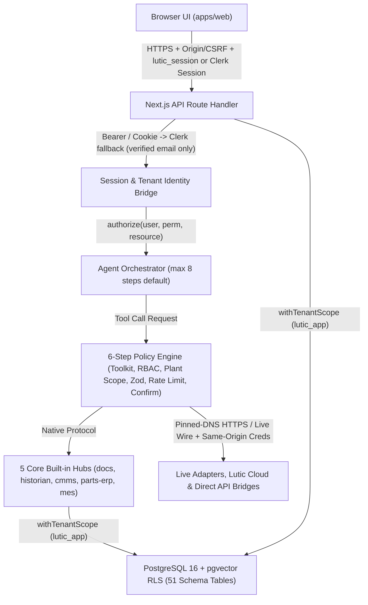

# Lutic Security and Threat Model

## 1. Security Architecture Overview

Lutic enforces authorization, tenant isolation, and tool access in server-side code. Production deployment calls for PostgreSQL with `pgvector`, TLS at the web ingress, unique secrets, and ClamAV for uploads. See the [production deployment guide](PRODUCTION.md).

## 2. Threat Model & Mitigations

### A. Prompt Injection and Model Context

Retrieved documents and tool results are delimited as untrusted data in the prompt. The policy engine separately enforces toolkit membership, permissions, plant scope, argument validation, and tool-specific result bounds. Connector credential handling stays server-side.

When chat uses an external LLM or external embedding gateway (`lutic-embed` / `openai`), it sends prompts and selected retrieval or tool context over HTTPS to the configured provider. All `/api/chat` and `/api/workflows/[id]/run` external LLM execution happens outside long database transactions (`runScopedDb`), keeping the latest 20 messages and enforcing the industrial `safety_verifier` gate (`clear` / `caution` / `hold_unverified`) before surfacing unverified numeric instructions.

### B. Identity, Role & Plant Scope

Session lookups check explicit `Authorization: Bearer ...` headers first (never falling back to browser cookies or Clerk on Bearer requests), then signed `lutic_session` cookies, and finally Clerk server sessions (`getClerkServerSessionUser()` in `apps/web/src/lib/clerk.ts`) when configured. Clerk identity bridging enforces `emailVerified === true` before linking `users.external_auth_id` to any existing active account, preventing unverified-email account takeover. Under `LUTIC_DEPLOYMENT_PLAN=enterprise` or an active Enterprise license, unknown external logins are denied (`null`); under `free` / `individual`, a fresh isolated workspace (`tenants.plan = 'free'`), starter plant, and `admin` role are provisioned in one transaction. API, `/board` (`board_issues`), and tool permission checks reload the active DB user, role, and `user_plants` scope on every request and audit denied calls.

### C. Cross-Tenant Access

All `50` tenant-owned tables (including `board_issues` in migration `v3`) run inside a transaction under the restricted `lutic_app` role where `withTenantScope` sets `app.current_tenant_id` (`51` total Drizzle schema tables including the global `worker_heartbeats` table, whose privileges are explicitly revoked from `lutic_app`). PostgreSQL row-level security hides rows from other tenants and rejects writes outside the scope. An empty tenant context gives the application role zero tenant rows. Bootstrap, initial identity lookup, and dedicated `lutic-worker` heartbeats use explicit administrative access.

### D. Writes, External Connectors & Code Mode

Agent work-order and part-reservation tools first create pending actions (`pendingActions[]` with `pendingAction` fallback). Confirmation verifies the user and uses an idempotency key. Authorized workflow steps can create local work orders, in-app notifications, and queue messages, and persist per-step checkpoints across retries (`resumeWorkflowRun`). Remote MCP (`remote_mcp`), UTCP/OpenAPI (`utcp_http`), and live HTTPS adapters execute via `safePinnedHttpRequest`, which pins the single resolved non-private IPv4/IPv6 address (blocking IPv4-mapped IPv6 bypasses and DNS rebinding), preserves TLS SNI, refuses 3xx redirects, enforces 15s timeouts, and caps responses at 1 MiB. Live OT adapters (`modbus://`, `mqtt(s)://`) validate endpoints against `isPrivateOrReservedIp` unless `LUTIC_ALLOW_PRIVATE_OT_NETWORKS=true` is explicitly configured for internal plant subnets. Generic `http`/`webhook` stubs and unregistered production workflow AI nodes fail closed (`HTTP 501` / error).

Production disables Code Mode (`isCodeModeEnabled()` in `packages/core/src/runtime.ts`) fail-closed across the shared executor (`packages/agent/src/code-mode.ts`), policy engine tool list (`packages/agent/src/policy.ts`), capability API (`/api/connectors`), and `POST /api/connectors/[id]/invoke` (`HTTP 501`). The development/test subprocess shares the app's filesystem and network permissions, so only run trusted scripts there. UTCP/OpenAPI (`packages/core/src/external-connectors.ts`) attaches stored connector credentials only when the resolved post-substitution target matches the configured connector origin (`targetUrl.origin === connectorUrl.origin`).

### E. Credential Protection, Rate Limiting & Uploads

- Connector credentials use AES-256-GCM at rest with `CREDENTIAL_ENCRYPTION_KEY`. Production session cookies are Secure, HttpOnly, and SameSite=Lax. Sign-out revokes the session token server-side.
- Database-backed fixed-window limits apply to login, chat, tool execution, and telemetry ingestion.
- Uploads check file type, enforce `MAX_UPLOAD_BYTES` with a 10 MiB default, and scan content with the background antivirus engine (**Lutic Security Scanner**, returning sanitized diagnostics without exposing internal host environment details). Production rejects uploads when the scanner is unavailable or returns an invalid response.
- State-changing cookie-authenticated requests check the supplied Origin against the host and allowed origins. HTTP responses enforce strict CSP (`apps/web/next.config.mjs` allows Clerk/Turnstile origins only when `NEXT_PUBLIC_CLERK_PUBLISHABLE_KEY` is configured), frame, content-sniffing, and referrer protections.

## Verification and Dependency Status

Across `21` Vitest suites (`138` total tests), `131` tests run locally (`20` files covering tenant isolation, request authorization, session invalidation, Clerk provisioning & Enterprise invite guards, `/board` RBAC/RLS, white-labeled connector catalog & scanner protocol handling, DNS-pinned SSRF transport, binary Modbus TCP & MQTT 3.1.1 wire clients, 1536-dim dense RAG, incremental SSE streaming, short DB transactions, safety gate checks, durable workflow checkpointing/resume, worker heartbeats, same-origin external bridges, and fail-closed production Code Mode guards + dev/test `SIGKILL` timeout), and `7` native PostgreSQL multi-connection RLS tests (`tests/postgres-integration.test.ts`, skipped locally without `POSTGRES_TEST_URL`) plus Docker `container-smoke` (`"currentVersion":4`) run in GitHub CI ([.github/workflows/ci.yml](.github/workflows/ci.yml)). `bun audit --audit-level=high` passes with `0` vulnerabilities across `768` packages. Live HTTPS TLS termination, live Clerk OAuth on `lutic.app`, live scanner uploads, live AI Gateway upstream calls, and encrypted backup restores remain to be verified on target staging before client rollout.
